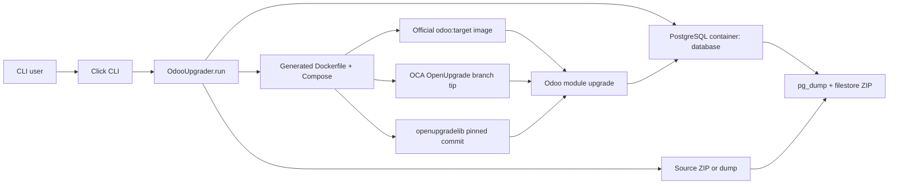

# OdooUpgrader system architecture

**Inspection basis (2026-10-30):** local branch `cursor/pin-openupgradelib-commit`, commit `49c16285eb160b11d8a977bba278bf3a3bc333f1`. `CONFIRMED` means directly visible in this revision; no runtime migration was executed. Upstream revision references are in [OPENUPGRADE_INTEGRATION.md](OPENUPGRADE_INTEGRATION.md).

## Application and ownership

`CONFIRMED` The tracked application is a Python CLI wrapper around Docker Compose, PostgreSQL utilities, the official `odoo:<target>` image, and OCA OpenUpgrade. It does not implement business-data transformations itself. The tracked implementation comprises [CLI](../../src/odooupgrader/cli.py#L15-L70), [entry point](../../src/odooupgrader/__main__.py#L1-L4), and [one orchestration class](../../src/odooupgrader/core.py#L19-L720). README is empty. No tracked tests or package manifest exist at this commit (`git ls-files`).

| Layer | Owner | Actual responsibility and entry | Inputs / outputs |
| --- | --- | --- | --- |
| CLI | OdooUpgrader | Click options, logging, constructs `OdooUpgrader`, calls `run()` ([cli.py:15-70](../../src/odooupgrader/cli.py#L15-L70)) | Source path/URL, target, optional addons, PG tag; console/log |
| Orchestration | OdooUpgrader | `run()` orders stages; helper methods create files and call subprocesses ([core.py:649-720](../../src/odooupgrader/core.py#L649-L720)) | Working-directory `source/`, `output/`, generated Compose/Dockerfile |
| Database | PostgreSQL container / OdooUpgrader commands | Compose service, `createdb`, `psql`/`pg_restore`, version SQL, `pg_dump` ([core.py:313-427](../../src/odooupgrader/core.py#L313-L427), [603-629](../../src/odooupgrader/core.py#L603-L629)) | Named volume and `database` database |
| Migration runner | Official Odoo image + OCA framework | `odoo --update all --stop-after-init`, `--load=...openupgrade_framework`, `--upgrade-path` ([core.py:476-535](../../src/odooupgrader/core.py#L476-L535)) | Updated database and `output/odoo.log` |
| Transformations | OCA OpenUpgrade + openupgradelib | Versioned scripts per module; framework patches Odoo module loading; library helpers ([OpenUpgrade framework](https://github.com/OCA/OpenUpgrade/tree/bf12c3cee6097145e53efa589b0d99a7e64d6a87/openupgrade_framework), [scripts](https://github.com/OCA/OpenUpgrade/tree/bf12c3cee6097145e53efa589b0d99a7e64d6a87/openupgrade_scripts/scripts)) | SQL/ORM changes during Odoo module upgrade |
| Output | OdooUpgrader | SQL dump + filestore ZIP, then removes extracted working data ([core.py:603-636](../../src/odooupgrader/core.py#L603-L636)) | `output/upgraded.zip` |

## Relationships

The dependency boundary is explicit in the generated image: OdooUpgrader owns CLI/Compose/packaging; OCA owns `openupgrade_framework`, `openupgrade_scripts`, and `openupgradelib`; official Odoo owns ORM and module migration dispatch; third-party host Python packages are Click, Rich, Requests, and Packaging ([imports](../../src/odooupgrader/core.py#L1-L13), [cli.py:1-4](../../src/odooupgrader/cli.py#L1-L4)); Docker/OS supply `git`, `apt`, `pip`, Compose and image runtime; PostgreSQL supplies restore/dump and the database volume. Transitive Python packages and exact OS libraries are **NOT VERIFIED**, because there is no lockfile or built-image manifest.



```mermaid
sequenceDiagram
  actor User
  participant CLI as cli.main
  participant App as OdooUpgrader.run
  participant PG as PostgreSQL container
  participant Docker as Docker Compose
  participant Odoo as Odoo + OpenUpgrade
  User->>CLI: --source --version [--extra-addons]
  CLI->>App: construct; run()
  App->>App: validate; clear directories; prepare addons
  App->>Docker: generate db-composer.yml; up -d
  Docker->>PG: start postgres tag
  App->>PG: createdb; restore ZIP SQL or custom dump
  App->>PG: query base latest_version
  loop each major version until target
    App->>Docker: generate Dockerfile/Compose; up --build
    Docker->>Odoo: run odoo -u all with upgrade path
    Odoo->>PG: pre scripts; module loading; post/end scripts
    Docker-->>App: process/container exit status
    App->>PG: query base latest_version
  end
  App->>PG: pg_dump database
  App->>App: zip dump.sql + filestore
  App-->>User: output/upgraded.zip
  App->>Docker: down -v in finally
```

## Operational boundaries

`CONFIRMED` All run state is based on the process working directory, not a run identifier ([core.py:29-33](../../src/odooupgrader/core.py#L29-L33)). Generated files and containers use fixed names ([core.py:313-339](../../src/odooupgrader/core.py#L313-L339), [502-535](../../src/odooupgrader/core.py#L502-L535)). The PostgreSQL named volume is removed in `finally` by `down -v` ([core.py:638-720](../../src/odooupgrader/core.py#L638-L720)). There is no scheduler, API server, persistent job record, checkpoint store, metrics service, or resume command in the tracked code. Logging is console/Rich plus optional file and Odoo's mounted log ([cli.py:6-12](../../src/odooupgrader/cli.py#L6-L12), [core.py:527-529](../../src/odooupgrader/core.py#L527-L529)).

`NOT VERIFIED` Installed package metadata under ignored `src/odooupgrader.egg-info` and cached test bytecode are local artifacts, not evidence of current tracked packaging or successful tests. Docker image digests, actual OpenUpgrade clone SHAs, DB contents, and production topology were unavailable.
