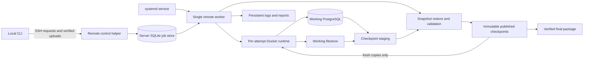

> Historical Phase 2 proposal. Implementation scope is superseded by [the focused local CLI plan](../implementation/FOCUSED_PLAN.md); worker, SSH, systemd and asynchronous-service recommendations are excluded.

# Phase 2 architecture review

Date: 2026-10-30. Status: **PROPOSED DESIGN; no implementation or migration executed**. All eight documents under `docs/discovery/` were read. The application remains on `cursor/pin-openupgradelib-commit`, SHA `49c16285eb160b11d8a977bba278bf3a3bc333f1`. Source references below are tied to this SHA unless another revision is given. Phase 1 documents are retained as historical analysis.

## Evidence and corrections to Phase 1

| Evidence ID | Rechecked finding | Classification and consequence |
| --- | --- | --- |
| L1 | [cli.py:15–70](../../src/odooupgrader/cli.py#L15-L70) is one Click command; [core.py:649–720](../../src/odooupgrader/core.py#L649-L720) executes synchronously | CONFIRMED existing. No job store, resume interface, SSH transport, or background worker |
| L2 | [core.py:29–33, 123–142](../../src/odooupgrader/core.py#L123-L142) uses CWD and deletes source/output before work | CONFIRMED. Persistent job roots and protected input custody are required |
| L3 | [core.py:313–408](../../src/odooupgrader/core.py#L313-L408) uses fixed containers/network, default PG 13, ignores restore exit status | CONFIRMED. Restore, ownership, and isolation gates must precede resume |
| L4 | [core.py:476–535](../../src/odooupgrader/core.py#L476-L535) builds from floating Odoo tags and OpenUpgrade branches; only openupgradelib is pinned | CONFIRMED. The actual remote image/OCA revisions remain NOT VERIFIED |
| L5 | [core.py:516–518](../../src/odooupgrader/core.py#L516-L518) binds `./output` and `./output/filestore` | CONFIRMED deployment mismatch risk: the user runs locally against a remote Docker daemon. Docker resolves mounts on the daemon host, not the client ([Docker documentation](https://docs.docker.com/engine/storage/bind-mounts/)). Presence of matching remote paths/shared storage is unknown |
| L6 | [core.py:550–601](../../src/odooupgrader/core.py#L550-L601) checks process/container exit; [603–720](../../src/odooupgrader/core.py#L603-L720) packages and removes DB volume | CONFIRMED. Exit 0 is insufficient evidence, and failure cleanup prevents durable recovery |
| L7 | `git ls-files` has no package manifest or test source. README contains a single heading | CONFIRMED. Phase 1 called README empty: more precisely, it contains no operational documentation. Cached test bytecode is not a reproducible test suite |
| U1 | Odoo 19 [loading.py:267–273](https://github.com/odoo/odoo/blob/a5447ae78fa15f25e69ce44fd154bf1d2f1e383a/odoo/modules/loading.py#L267-L273) commits per upgraded module | VERIFIED UPSTREAM. A failed version step can contain committed partial changes; restore a checkpoint before retry |
| U2 | Odoo 19 [loading.py:487–507](https://github.com/odoo/odoo/blob/a5447ae78fa15f25e69ce44fd154bf1d2f1e383a/odoo/modules/loading.py#L487-L507) logs missing modules/inconsistent states; [registry.py:163–176](https://github.com/odoo/odoo/blob/a5447ae78fa15f25e69ce44fd154bf1d2f1e383a/odoo/orm/registry.py#L163-L176) can enable updates from `base.partially_updated_database` | VERIFIED UPSTREAM. Inspect SQL before normal registry startup; probe only a disposable snapshot restore |
| U3 | Odoo 18 [UoM write:171–180](https://github.com/odoo/odoo/blob/c35f52004d75c19c296e49e9a99e9b8d4447d67f/addons/uom/models/uom_uom.py#L171-L180) conditionally skips uniqueness checking for writes setting reference type and a context flag | VERIFIED UPSTREAM correction: Phase 1 overstated that ordinary ORM writes always prevent duplicate references. Duplicate origin cannot be assigned to direct SQL or a customer without incident evidence |

The user confirmed **local CLI → remote Docker daemon**, hosted at **Contabo**, and described the server as **Ubuntu “24.4”**. Ubuntu 24.04 is a planning assumption, not verified OS inventory. SSH access, systemd version, Docker transport, filesystem, capacity, backups, source edition and installed modules remain unknown. No remote host was contacted.

## Source revision register

Rechecked through the GitHub integration on the date above:

- OpenUpgrade 17.0: `61daab09ab6c0d21234b96374d9291d3e02ee9e4`; 18.0: `a393ddbe56b6913eea1e77b42be93152ac00b16d`; 19.0: `bf12c3cee6097145e53efa589b0d99a7e64d6a87`. These are observed upstream branch heads, **not tested or approved runtime pins**.
- Application's openupgradelib pin: `565d0b33391271a4b2ac27eff8ae19f72fe27d77`; [helper source](https://github.com/OCA/openupgradelib/blob/565d0b33391271a4b2ac27eff8ae19f72fe27d77/openupgradelib/openupgrade.py#L1515) contains `add_inherits_parent_xmlids`. OpenUpgrade 18 [base pre script:100](https://github.com/OCA/OpenUpgrade/blob/a393ddbe56b6913eea1e77b42be93152ac00b16d/openupgrade_scripts/scripts/base/18.0.1.3/pre-migration.py#L100) uses it. The pin commit itself is a documentation update; availability is established by reading the helper, not by its commit title.
- Official Odoo research revisions: 18.0 `c35f52004d75c19c296e49e9a99e9b8d4447d67f`; 19.0 `a5447ae78fa15f25e69ce44fd154bf1d2f1e383a`. Neither is established as the code inside the remote images.
- [PR #6054](https://github.com/OCA/OpenUpgrade/pull/6054): open/unmerged, head `5720f589e0760db3584cc19d19105feaf8fa9870`, base 19.0. [PR #2666](https://github.com/OCA/OpenUpgrade/pull/2666): merged into 14.0 on 2021-06-06, merge SHA `2e21962b2782a06366bc091e51b104825373879e`.

## Recommended target

**PROPOSED:** retain a Python CLI and Docker migration runtime. Add a small persistent job engine on the remote server, supervised by systemd. The local CLI uploads immutable inputs and submits short requests over SSH; a single remote worker executes jobs independently of SSH. SQLite on local server storage holds job state; PostgreSQL custom-format dumps and complete filestore copies form immutable checkpoints. Every retry restores a new working database and filestore from the latest verified checkpoint. PostgreSQL/Odoo containers are per attempt, labeled and inaccessible outside the migration host's isolated networks.

Proposed components under `src/odooupgrader/`: `jobs/` (models, SQLite repository, transitions, locks), `engine.py` (workflow), `checkpoints/` (snapshot store/publication/restore), `runtime/` (Docker/PostgreSQL/process handling), `validation/` (version adapters and rules), `diagnostics/` (error evidence), `dependencies.py` (runtime manifests), `worker.py`, `remote.py` (client transport), `remote_agent.py` (bounded server control), `artifacts.py`, `storage.py`, `cli.py`. These are boundaries inside one package, not independently deployed microservices. Keep `core.OdooUpgrader` as a compatibility facade while routing calls through the new engine.

## Alternatives and decisions

| Area / alternative | Reliability, safety and recovery | Complexity, maintenance and performance | Decision |
| --- | --- | --- | --- |
| JSON as job authority | Atomic file replacement possible; cross-file job/attempt/event consistency and concurrent claims must be custom built | Low initial cost, high correctness burden; easy inspection | JSON only for immutable manifests and exports |
| SQLite job authority | Transactions couple events, ownership and state; independent of migration PG; host-local recovery | Low operational cost; one writer suits one worker; use short transactions | **Choose** local filesystem, rollback journal, synchronous EXTRA, FK enforcement; backup API |
| PostgreSQL job authority | Good multi-host coordination and concurrency, but separate durable control DB required | Higher operations/backup cost; justified for future distributed workers | Defer; never store control state in migration DB |
| PG clone databases | Fast same-cluster copy; requires source quiescence; shares cluster failure and cannot preserve filestore by itself | Higher coupling to PG version/host and storage | Optional future optimization, not durable checkpoint authority ([CREATE DATABASE](https://www.postgresql.org/docs/16/sql-createdatabase.html)) |
| PG dump + filestore | Portable recovery files; restore-tested; database and files paired under quiescence | More time and disk; predictable dependencies | **Choose** custom dump and complete file manifest/copy |
| Filesystem snapshots | Fast where supported; multi-volume consistency, WAL/PG physical recovery and filesystem semantics must be certified | Highest environment coupling; unknown Contabo filesystem | Defer behind same checkpoint interface |
| Detached CLI/nohup | May outlive SSH, lacks robust boot reconciliation and durable scheduling by itself | Lowest initial cost, ongoing manual operations | Insufficient default |
| Per-job systemd units | Supervised, but queue/ownership/state still required | Moderate lifecycle complexity for many units | Viable later; avoid initially |
| Dedicated worker supervised by systemd | One durable queue; restarts controller and reconciles jobs after boot; no broker | Moderate code, low operations; one active attempt initially | **Choose** one system service with SQLite queue |
| Manual retry from checkpoint | Explicit retry after diagnosis; always a clean working copy | Simple and safe; human response required | **Default** migration retry policy |
| Rule-based automatic recovery | Safe for bounded transport retries, unsafe for unknown or semantic DB changes | Rules need version bounds/evidence/tests | Only pre-migration transport retries; no automatic migration reruns in first release |
| Approved remediation | Auditable clone-only changes with before/after proof and rollback | More review; necessary for data ambiguity | Required for data transformations or dependency-plan changes |

SQLite's atomicity still depends on working locking/fsync/storage ([atomic commit](https://www.sqlite.org/atomiccommit.html)); this is not a guarantee against server/disk loss. The remote design includes off-host backup and restore exercises. The systemd design is based on [documented service behavior](https://www.freedesktop.org/software/systemd/man/255/systemd.service.html), with installed-version verification before rollout.

## Scope and design constraints

First qualification scope: Community 16→17→18→19, plus initial source checkpoint at each supported source. Preserve old CLI syntax, but do not certify the existing 10–15 version choices without their own runtime/validation adapters. Enterprise/custom modules require versioned sources, explicit module mappings and applicable validation; unknown coverage blocks the job. Runtime qualification, repairs, new services, and deployment are Phase 3 work requiring the user's approval. The design does not support writing directly to a customer's live database.

See [resume](RESUME_ENGINE_DESIGN.md), [remote operation](REMOTE_EXECUTION_DESIGN.md), [error registry](MIGRATION_ERROR_REGISTRY.md), [dependency control](OPENUPGRADE_HARDENING_PLAN.md), [task roadmap](DEVELOPMENT_ROADMAP.md), and [tests](TEST_STRATEGY.md) for implementation contracts.
