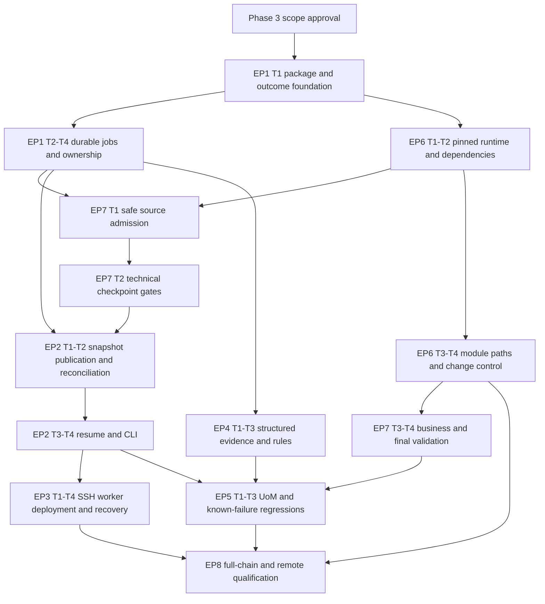

> Historical Phase 2 proposal. Implementation scope is superseded by [the focused local CLI plan](../implementation/FOCUSED_PLAN.md); worker, SSH, systemd and asynchronous-service recommendations are excluded.

# Development roadmap and approval gates

**IMPLEMENTATION PLAN ONLY. No Phase 3 work authorized or performed.** Complexity is qualitative, not a delivery estimate. No dates or staffing commitments are implied. Paths beginning with `tests/`, `tools/`, `deploy/`, `docs/`, `.github/` and root packaging files are repository-relative; other Python component paths are relative to `src/odooupgrader/`. **NEW** identifies proposed files, not existing implementation. Existing application entry points are `src/odooupgrader/{core.py,cli.py,__main__.py,__init__.py}`. Test IDs refer to [TEST_STRATEGY.md](TEST_STRATEGY.md); error IDs refer to [MIGRATION_ERROR_REGISTRY.md](MIGRATION_ERROR_REGISTRY.md).

## Priority and implementation dependency graph

Resume is the highest product priority. Its first usable increment must include durable ownership, verified runtime contracts, safe restore and minimum validation; a CLI command that reruns a partial database is not a resume milestone. Build these prerequisites narrowly before expanding operational or diagnostic features.

EP8 test scaffolding starts with EP1 and tests accompany each task; the graph's EP8 node means final qualification, not deferred testing. Minimum structured errors/events are built in EP1; richer classifications follow in EP4. A synthetic technical resume demonstration may precede business adapters, but no customer migration is accepted until its applicable EP7 gates pass. Stage remote protocol/schema early with EP1; deploy it only after local engine invariants hold.

## EPIC 1 — Persistent jobs and execution ownership

**Objective:** durable job identity, state and exclusive execution across CLI calls. **Current problem:** synchronous `core.run()`, local CWD, fixed resources, swallowed errors and no tracked package/test foundation. **Architecture:** one SQLite authority with transactional state/events, kernel ownership lock, monotonic generation, unique attempts and a compatibility facade. **Dependencies:** design approval. **Complexity:** High. **Affected:** existing core/CLI/entry point; new job/runtime package components below.

| Task | Implementation scope and files | Acceptance / tests |
| --- | --- | --- |
| EP1-T1 | Establish clean packaging and CLI baseline; **NEW** `pyproject.toml`, `tests/conftest.py`, `tests/unit/test_cli.py`; existing `cli.py`, `__main__.py`, `core.py`. Separate success/failure outcomes, retain original exception evidence; implement supervised stream handling in **NEW** `runtime/processes.py` | Clean checkout builds/imports without ignored local artifacts. Exceptions return documented failures; high stderr cannot deadlock. K008/K011/K015, C5 |
| EP1-T2 | **NEW** `jobs/models.py`, `jobs/repository.py`, `jobs/schema.py`, `jobs/transitions.py`: schema, request idempotency, durable events and legal state CAS; initial sanitized error envelope | Restart preserves identity/history; invalid transitions and changed duplicate payload rejected; state/event atomic. C1/C6 |
| EP1-T3 | **NEW** `jobs/locks.py`, `runtime/docker.py`, `runtime/postgres.py`: fixed-inode lock, generation claims, exact resource labels/IDs, per-attempt isolation, fatal restore commands; replace fixed resource logic in existing `core.py` | Two claims cannot create overlapping writers; unrelated Docker resources untouched; bad restore blocks. R8/E4/E6, C3 |
| EP1-T4 | **NEW** `engine.py`, `worker.py`; adapt existing `core.OdooUpgrader` as facade. Dispatch persisted stages, cancellation and interruption reconciliation; one active attempt, no auto migration retry | Process loss yields evidence and explicit recovery state, no partial-volume replay. C1/R5/R8; run against synthetic adapter until EP2/EP7 complete |

**Risks:** transaction/filesystem boundaries, app schema evolution and legacy CLI behavior. **Rollback:** do not attach the legacy engine to new job roots; stop dispatch, preserve metadata backup and all artifacts, then restore only a schema-compatible application/ledger. Failed attempts remain evidence. **Definition of Done:** all task acceptance checks pass, schema/CLI contracts documented, and no claim of working resume until EP2/EP7 integration passes.

## EPIC 2 — Verified checkpoints and resume

**Objective:** resume the next incomplete transition without repeating successful transitions. **Current problem:** no checkpoint metadata, verification or recovery; finally-cleanup destroys the working DB. **Architecture:** immutable paired dump/filestore, restore-tested publication, explicit latest pointer, fresh attempt restores. **Dependencies:** EP1-T2–T4, EP6-T1–T2, EP7-T1–T2. **Complexity:** Very High. **Affected:** replace checkpoint/finalization/cleanup responsibilities in `core.py`; new checkpoint components.

| Task | Implementation scope and files | Acceptance / tests |
| --- | --- | --- |
| EP2-T1 | **NEW** `checkpoints/models.py`, `checkpoints/store.py`, `checkpoints/snapshot.py`, `storage.py`; dump/filestore pairing, manifests/hashes, capacity reservation, CP0 and staging intents | Full files/dump verified; missing attachments and failed restore prevent CP0/publication. C2/C3/D4/E7 |
| EP2-T2 | **NEW** `checkpoints/publication.py`, `checkpoints/reconcile.py`; fsync/rename/ledger protocol, orphan receipt rules, parent/generation checks and INVALID state | Every publication crash window preserves authority; corrupt latest blocks without fallback. R4/R6/C2/D6 |
| EP2-T3 | **NEW** `checkpoints/restore.py`, `jobs/resume.py`; verify fingerprints and fresh DB/filestore, explicit resolution/plan acceptance, resume target checkpoint into finalization only | R1/R2/R5/R6/R7/R8 pass with dispatch counts, distinct working resources and immutable prior hashes |
| EP2-T4 | Existing `cli.py`; **NEW** `cli_jobs.py`, `tests/integration/test_resume.py`: jobs list/status/logs/checkpoints/wait/cancel/export, resume/dry-run, legacy wait compatibility and error envelope | Dry-run has zero mutations; async accepted differs from completed; cancellation races safe; legacy/export behavior documented. C1/C5/D6 |

**Risks:** DB/filestore consistency, restore costs, incomplete publication and falsely accepted version state. **Rollback:** disable new dispatch; retain last published checkpoint and ledger, quarantine incomplete candidates; revert implementation with compatible metadata backup. Never fall back to older checkpoints or rerun completed transitions silently. **Definition of Done:** real PostgreSQL snapshot/restore and R1/R2/R5–R8 pass; no customer readiness without applicable business and remote gates.

## EPIC 3 — Remote execution and operations

**Objective:** local CLI submits to Contabo-host worker; SSH loss cannot terminate accepted jobs. **Current problem:** local-generated paths are used against a remote Docker daemon, with no remote controller. **Architecture:** bounded SSH helper protocol, resumable hashed uploads, persistent single systemd worker, host-local storage and explicit reconciliation. **Dependencies:** EP1, EP2 technical resume milestone; EP7 intake; approved deployment prerequisites. **Complexity:** High.

| Task | Implementation scope and files | Acceptance / tests |
| --- | --- | --- |
| EP3-T1 | **NEW** `remote.py`, `remote_agent.py`, `remote_protocol.py`; exact helper invocation, host-key checks, structured request validation, idempotency and bounded transfers; integrate existing `cli.py` | Distinct client/server paths work; lost acknowledgement resolves to same job; partial assets never run; no shell argument injection. R3/C4/C5 |
| EP3-T2 | **NEW** `deploy/systemd/odooupgrader-worker.service`, `deploy/config.example.toml`, `docs/operations/installation.md`; implement host preflight in `worker.py`/`storage.py` | Disposable Ubuntu installation verifies mounts/permissions/daemon; worker independent of login and starts at boot; migrations never auto-restart. R3/R4/C6 |
| EP3-T3 | **NEW** `jobs/reconcile.py`, `tests/remote/test_reconciliation.py`; inspect boot/daemon IDs, quiesce proven orphan writers, block unknown ownership, preserve logs and checkpoints | Reboot, worker kill and Docker restart safe; no unrelated resource deletion or stale-time takeover. R4/R8/E6/C6 |
| EP3-T4 | **NEW** `operations/backup.py`, `operations/retention.py`, `docs/operations/recovery.md`; SQLite backup API, consistent recovery-set manifest, explicit retention preview, storage alarms and off-host restore procedure | Restore tested on separate host; active/referenced evidence cannot be collected; full disk never triggers destructive pruning. E7/C6/C7 |

**Risks:** Docker privileges, disk/fsync behavior, unknown actual Ubuntu/storage configuration and remote operator access. **Rollback:** stop accepting submissions, drain or explicitly interrupt owned attempts, preserve durable job root/backups, disable worker only after reconciliation; restore compatible service/package/config. No automated host cleanup. **Definition of Done:** R3/R4 with real SSH and disposable reboot, backup restore and permission tests pass; existing Contabo deployment still requires separately approved installation.

## EPIC 4 — Migration diagnostics and error evidence

**Objective:** explain failures and safe recovery steps consistently. **Current problem:** text logs and broad exception handling lack durable attempt/error lineage. **Architecture:** structured evidence, version-scoped classifiers, protected reports, UNKNOWN fallback and reviewed resolution records. **Dependencies:** EP1 event/outcome models; EP6 manifest identity. **Complexity:** Medium–High.

| Task | Implementation scope and files | Acceptance / tests |
| --- | --- | --- |
| EP4-T1 | **NEW** `diagnostics/models.py`, `diagnostics/logging.py`; concurrent process evidence, log cursors/rotation, sanitized summaries, protected raw logs, resource and SQLSTATE data | Reconnect log follow works; secrets absent from public output; process/OOM/DB evidence retained without reporting uncommitted state. C4/C5/E6 |
| EP4-T2 | **NEW** `diagnostics/classifier.py`, `diagnostics/registry.json`; encode K001–K018 and prospective classes with stage/version/evidence constraints | E1–E8 classify only with sufficient proof; deceptive text/conflicting matches become UNKNOWN. Missing original incident evidence remains explicit |
| EP4-T3 | **NEW** `diagnostics/resolutions.py`, `reports.py`; approved remediation/plan records and command diagnostics; integrate `jobs/resume.py` and `cli_jobs.py` | UNKNOWN never auto-retries; human disposition references exact evidence and planned verification; no generic force bypass. E8/R7/C5 |

**Risks:** false positive classification, sensitive logs and confusing acceptance with successful recovery. **Rollback:** disable a faulty classifier/rule while retaining raw evidence; fall back to UNKNOWN and block unsafe resume. Revert report code without deleting history. **Definition of Done:** stable registry IDs and test evidence for each detector; no diagnostic rule can itself mutate a source DB or authorize an untested repair.

## EPIC 5 — Known migration fixes

**Objective:** resolve verified failure mechanisms with reusable, upstream-first corrections. **Current problem:** UoM duplicate roots and factor inversion, historical helper intent without a supplied runtime traceback, and wrapper defects. **Architecture:** read-only diagnostics, qualified upstream/dependency changes, narrowly approved clone-only normalization; no customer-specific patches. **Dependencies:** EP2 resume, EP4 evidence, EP6 change control and EP7 applicable business adapters. **Complexity:** High–Very High for semantic UoM validation.

| Task | Implementation scope and files | Acceptance / tests |
| --- | --- | --- |
| EP5-T1 | **NEW** `validation/uom.py`, `tests/fixtures/uom/`, `tests/migrations/test_uom_migration.py`; create faithful 18 fixtures, include inactive/provider/export-only XML IDs and source ORM uniqueness exceptions; reproduce K001/K002 | E1/E2 identify distinct causes; D3 validates semantic baseline, prices and rounding, not raw factor equality |
| EP5-T2 | **NEW** `diagnostics/rules/uom_reference.py`, `tests/migrations/test_uom_resolution.py`; implement diagnostic-only default and reviewed eligibility report. Enable normalization only after independently proved canonical mapping and whole-trial validation | Ambiguous/invalid cases block. Eligible opt-in rule preserves identifiers, factors and business links; D1–D3, R2/R5 pass. No first-row selection or source writes |
| EP5-T3 | **NEW** `runtime/contracts/`, `tests/migrations/test_known_failures.py`; qualify upstream bigger-unit correction and helper API, plus K004–K018 regression coverage in owning epics; use patch file under **NEW** `runtime/patches/` only if explicitly approved | E2/E3/H2/H5/H6 pass on exact runtime; affected old version fails expected regression; every K ID links passing prevention/detection coverage or explicit unresolved blocker |

**Risks:** semantically ambiguous UoMs, silent financial/stock changes, incomplete upstream fix and unsupported installed modules. **Rollback:** withdraw affected runtime/rule from admission, revert pending plan through explicit acceptance, discard working copy and restore unchanged checkpoint. No inverse SQL or source-factor hacks. **Definition of Done:** source mechanism and executable reproducer agree, approved fix passes whole-step/business tests, unresolved classes remain blocked and no claim of historical incident resolution without its evidence.

## EPIC 6 — Reproducible OpenUpgrade integration

**Objective:** qualified exact runtime per transition, visible plan changes and correct upstream execution. **Current problem:** floating images/branches, final-only custom sources, partial library pin and no complete module support contract. **Architecture:** immutable runtime manifests, build provenance, per-step modules and script inventory; retain Odoo/OCA loaders. **Dependencies:** EP1-T1; module inventory integration with EP7-T1; plan acceptance integration with EP2-T3. **Complexity:** High.

| Task | Implementation scope and files | Acceptance / tests |
| --- | --- | --- |
| EP6-T1 | **NEW** `dependencies.py`, `runtime/contracts/schema.json`, `runtime/images.py`; define source/target/PG/image/source-SHA/config/patch/dependency contract; replace Dockerfile generation in `core.py` with pinned templates under **NEW** `runtime/templates/` | No missing/floating provenance allowed; exact Odoo source established or runtime blocked. H1/R7 |
| EP6-T2 | **NEW** `tools/build-runtime.py`, `runtime/locks/`, `tests/integration/test_dependencies.py`; qualified dependency locks/wheel hashes, import/API probes, paired migration/verification images and staged offline execution | H1/H2/E3 pass; no customer data in build context; no runtime pip repair; source verification image qualified |
| EP6-T3 | **NEW** `runtime/modules.py`, `runtime/scripts.py`; per-step addon graph, rename/merge mapping, script inventory and additional-path collisions; integrate `dependencies.py` | Missing provider blocks; custom addons available on intermediate versions; actual Odoo/OCA order verified. E5/H3/H4 |
| EP6-T4 | **NEW** `jobs/plans.py`, `docs/operations/runtime-qualification.md`; explicit diff acceptance, upstream issue/patch retirement register and release contract approval | Unaccepted drift blocks; pending correction preserves completed prefix; app/schema changes tested. R7/H5/H6 |

**Risks:** build reproducibility, moving upstream status, platform dependency conflicts, private Odoo APIs and accidental unsupported Enterprise claims. **Rollback:** revoke bad contract for new work, retain its image/provenance for diagnosis; select only a previously qualified pending contract via explicit plan change and fresh restore. **Definition of Done:** each advertised path has all H gates, exact manifests and compatible adapters; branch heads or open PRs alone never qualify a release.

## EPIC 7 — Migration integrity validation

**Objective:** make successful checkpoints meaningful. **Current problem:** weak restore handling, exit-only success, no paired attachment or business integrity checks. **Architecture:** V1/V2/V3 version-scoped adapters and required/conditional applicability rules with hashed reports. **Dependencies:** EP1 isolated runtime and EP6 pins; EP2 publication integration; business inputs require approved mappings. **Complexity:** Very High.

| Task | Implementation scope and files | Acceptance / tests |
| --- | --- | --- |
| EP7-T1 | **NEW** `intake.py`, `validation/source.py`, `validation/base.py`; safe archive/download/filestore input, actual source detection, module inventory, dependency/space gates and immutable baseline; replace intake in existing `core.py` | C3/C4/E3/E5/E7/D5 pass; source assertion mismatch rejected; no CP0 on invalid source registry/files |
| EP7-T2 | **NEW** `validation/adapters/odoo16.py`, `odoo17.py`, `odoo18.py`, `odoo19.py`, `validation/registry.py`, `validation/attachments.py`; verify actual version APIs, raw SQL before disposable normal registry load, pending states/partial markers, schema/model checks, paired restore | V2 fails on exit-0/pending/missing modules or invalid attachments; real pinned version adapters pass. E4/E5/E6/D4/C3 |
| EP7-T3 | **NEW** `validation/accounting.py`, `validation/inventory.py`, `validation/uom.py`, `validation/profiles.py`; semantic mappings, applicability, cumulative baseline, declared tolerances and protected comparisons | D1/D2/D3 across each qualified step and full chain; unavailable required adapter blocks rather than silently skips |
| EP7-T4 | **NEW** `artifacts.py`, `validation/final.py`, `tests/integration/test_artifacts.py`; final report, target-format compatibility, final package restore, atomic publication/download; replace existing `finalize()` behavior | D6/C2/C5; failed finalization leaves target checkpoint usable, exports only published verified artifact |

**Risks:** false confidence from generic checks, legitimate transformed records, custom storage and business-specific semantics. **Rollback:** failed checks block publication; withdraw an invalid adapter and require revalidation, never retroactively edit an old PASS report. Keep immutable earlier checkpoint; changes to validation contract follow accepted plan policy. **Definition of Done:** technical gates plus all applicable business gates pass; report distinguishes unsupported/blocked/untested cases and separate customer UAT.

## EPIC 8 — Regression, failure injection and release qualification

**Objective:** prove the recovery and data-safety contracts before release. **Current problem:** no tracked automated tests or reproducible package foundation. **Architecture:** unit, real isolated integration, pinned migration and remote VM suites; stable fixture/evidence manifests. **Dependencies:** incremental on all preceding tasks; release after all applicable gates. **Complexity:** High, with potentially expensive full-chain/VM runs.

| Task | Implementation scope and files | Acceptance / tests |
| --- | --- | --- |
| EP8-T1 | **NEW** `tests/unit/`, `tests/integration/`, fixture builders and `tests/conftest.py`; CI foundation in existing `.github/workflows/upgrade-test-{ubuntu,macos,windows}.yml` | Fast deterministic state/CLI/input tests; isolated daemon identity guard; meaningful critical-rule coverage and C1–C5 |
| EP8-T2 | **NEW** `tests/migrations/`, `tests/fixtures/manifest.json`, `tests/integration/test_checkpoint_publication.py`; full chains, known-error reproductions and every crash window | R1/R2/R5–R8, E1–E8, D1–D6, H1–H6 with exact runtime/fixture hashes and no unexplained skips |
| EP8-T3 | **NEW** `tests/remote/`, `tools/remote-test-harness/`, `docs/operations/qualification-report.md`; disposable VM SSH/reboot/backup tests and measured storage/runtime budgets | R3/R4/C6/C7 on separate client/server paths; consistent recovery set restores to another isolated host |
| EP8-T4 | Existing `.github/workflows/publish-pypi.yml`, `README.md`; **NEW** `docs/operations/release.md`; enforce gate results, document supported profiles/CLI changes, controlled installation and rollback rehearsal | Release blocked by required failures/NOT TESTED; installer/service rollout reviewed; published support matrix matches actual executed evidence |

**Risks:** accidental use of real remote Docker context, expensive/flaky fixtures and leakage in CI. **Rollback:** stop promotion, retain evidence, revert release candidate and restore verified runtime/control-state compatibility; no host rollback experiment on Contabo without separate approval. **Definition of Done:** all advertised capabilities have executed passing evidence, no fabricated tests or hidden skips, documentation matches behavior and user approval precedes rollout.

## Milestones, decisions and handover

- **M1 durable foundation:** EP1 + EP6-T1–T2 + EP7-T1–T2, with their tests. No resume promise yet.
- **M2 safe resume:** EP2 and required fault injection prove R1/R2/R5–R8 on qualified synthetic profiles. This is the first priority feature acceptance.
- **M3 remote operation:** EP3 with real SSH/reboot/backup evidence. No deployment assumption based on local tests.
- **M4 migration qualification:** EP4–EP7 complete for advertised module profiles; UoM fix and business checks pass.
- **M5 release:** EP8 final suite, approved operational policy and separate authorized customer trial. Phase 2 does not authorize any milestone implementation or server change.

Before development approve the architecture, initial Community 16–19 qualification scope, explicit CLI/export behavior changes, source-provenance build policy and human-approved repair policy. Retention/capacity/backup settings and actual Contabo inventory are deployment prerequisites; they need not delay isolated foundation development. See [PHASE2_EXECUTIVE_SUMMARY.md](PHASE2_EXECUTIVE_SUMMARY.md) for the decision checklist. Each task closes only with reviewed implementation, its stated tests actually executed, documentation updated and rollback consequences understood; incomplete qualification stays explicit.
