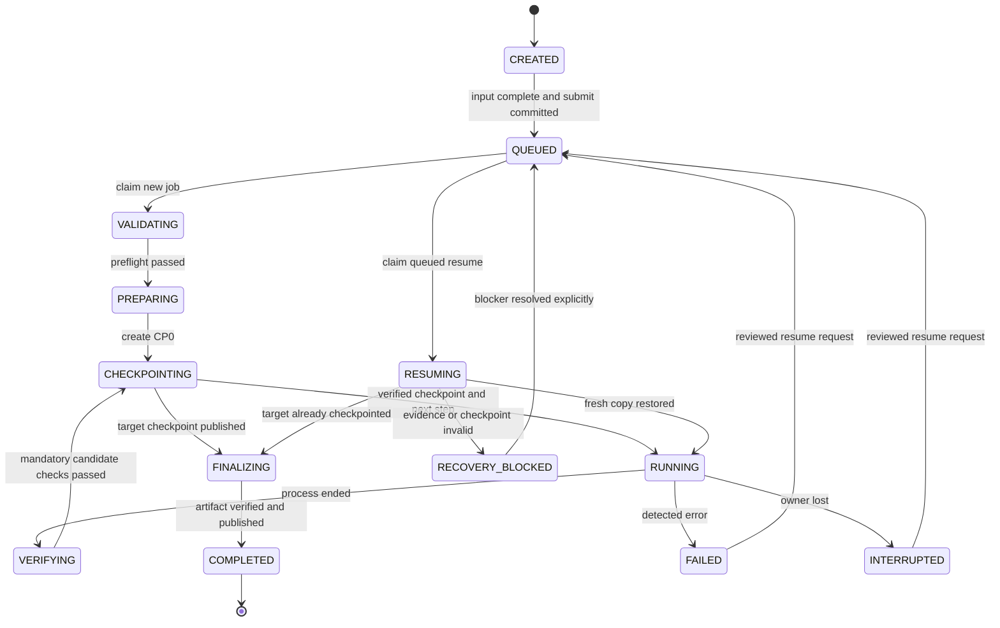

> Historical Phase 2 proposal. Implementation scope is superseded by [the focused local CLI plan](../implementation/FOCUSED_PLAN.md); worker, SSH, systemd and asynchronous-service recommendations are excluded.

# Persistent jobs, checkpoints and resume

**PROPOSED, not implemented.** Evidence and source revisions: [architecture review](ARCHITECTURE_REVIEW.md). The unit of retry is an entire version transition restored from a verified checkpoint. OpenUpgrade scripts are never assumed idempotent. A source checkpoint, CP0, is created after safe restore and source validation, before the first transition.

## Invariants

1. Original inputs, published checkpoints and their provenance are immutable. Only attempt working copies can be modified.
2. A completed step references a published, checksum-valid, restore-tested checkpoint whose mandatory checks passed. Container exit 0 alone changes no completed-step pointer.
3. A job has one execution owner; an attempt has a unique generation and Docker resources. No retry reuses its predecessor's mutable database or filestore.
4. Latest checkpoint is an explicit ledger pointer. Missing/corrupt latest checkpoint blocks recovery; never select an older checkpoint implicitly.
5. Any dependency/configuration change is compared and recorded before execution. Completed prefix provenance cannot be rewritten.
6. An unknown failure stops migration scheduling until classified or explicitly reviewed; having a snapshot does not make the cause safe to retry.
7. Successful final artifact publication and COMPLETED state require final verification. Failed candidates cannot appear as successful downloads.

## Persistent model

Proposed single SQLite database `/var/lib/odooupgrader/state/jobs.sqlite3`, owned by the service account, on host-local durable storage. Use `journal_mode=DELETE`, `synchronous=EXTRA`, `foreign_keys=ON`, and bounded `busy_timeout`; query values back at startup. Transactions are short; no Docker command, file copy, hashing or migration is held inside a SQL write transaction. These choices use [SQLite durability settings](https://www.sqlite.org/pragma.html#pragma_synchronous); filesystem and server storage still require qualification.

| Entity | Required fields and constraints |
| --- | --- |
| Job | UUIDv4 `job_id`; schema version; UTC creation/update; state; monotonic `state_version`; request id unique per operator; input-ready flag; target/source major; source asset digest; module/edition profile; initial plan hash; active plan revision; latest checkpoint ID; current stage; cancel flag; final artifact ID; owner generation. Source is detected, not trusted from CLI |
| Step | `(job_id, ordinal)` unique; source/target major; expected predecessor checkpoint; immutable runtime contract; planned module mapping; status; successful attempt/checkpoint IDs; number of attempts |
| Attempt | UUID; job/step IDs; attempt ordinal unique; owner generation; start/end UTC; host/boot identity; phase; input checkpoint ID+digest; plan hash; app commit; runtime image digests; Docker daemon identity and exact resource IDs; exit/signal/OOM fields; validation/error IDs; resolution ID |
| Checkpoint | UUID; job/step/attempt; parent checkpoint ID+manifest digest; kind SOURCE or TRANSITION; status STAGING/PUBLISHED/INVALID/QUARANTINED; canonical path; manifest digest; verification report digest; size; UTC publication; validation-profile version |
| Event | Append-only job sequence; old/new state; stage; attempt; reason; evidence references; request/operator identity; UTC; app/schema version. Same transaction as each authoritative state change |
| Error | Stable registry ID or UNKNOWN; confidence; class; exception/SQLSTATE/exit details; protected log references; attempt; resolution requirement; append-only history |
| Resolution / plan revision | Parent hash; sanitized before/after diff; reason; operator identity; explicit acceptance digest; tested compatibility evidence; scope (pending steps only); creation UTC |
| Asset / artifact / request | Content hash, expected length, stored location, upload offsets and expiry; publication state; durable idempotency key; response. Artifact is selectable only after publication |

Every mutation uses expected state/version and owner generation (compare-and-set); append an event in the same transaction. Foreign keys prohibit publishing a step/checkpoint for another job or attempt. Unique constraints reject duplicate active claims and duplicate submission IDs. JSON files export immutable manifests and reports; they are not a competing writable job-state authority. Metadata stores credential references, never passwords, tokens, signed URLs, private keys or database row payloads.

## State machine

The diagram shows the main path; the transition table is authoritative:

| From | Legal destinations and guard |
| --- | --- |
| CREATED | QUEUED after all inputs verified and request committed; CANCELLED before submission |
| QUEUED | VALIDATING for new job; RESUMING for queued resume; CANCELLED. Dispatch intent distinguishes new/resume |
| VALIDATING | PREPARING on pass; FAILED with `VALIDATION_FAILED`; INTERRUPTED; CANCEL_REQUESTED |
| PREPARING | CHECKPOINTING for CP0; FAILED; INTERRUPTED; CANCEL_REQUESTED |
| RUNNING | VERIFYING only after supervised process has ended; FAILED; INTERRUPTED; CANCEL_REQUESTED |
| VERIFYING | CHECKPOINTING; FAILED with failing gate; INTERRUPTED; CANCEL_REQUESTED |
| CHECKPOINTING | RUNNING for next step; FINALIZING at target; FAILED; INTERRUPTED; CANCEL_REQUESTED. Advance only in checkpoint publication transaction |
| FINALIZING | COMPLETED after atomic artifact publication; FAILED; INTERRUPTED; CANCEL_REQUESTED |
| FAILED / INTERRUPTED / RECOVERY_BLOCKED | QUEUED on accepted resume request, then RESUMING on worker claim; RECOVERY_BLOCKED on reconciliation failure; CANCELLED by explicit cancellation |
| RESUMING | RUNNING after restore/preflight; FINALIZING if final checkpoint exists; RECOVERY_BLOCKED; INTERRUPTED; CANCEL_REQUESTED |
| CANCEL_REQUESTED | CANCELLED only after owned processes are quiesced and evidence retained; RECOVERY_BLOCKED when their identity/status cannot be established |
| CANCELLED / COMPLETED | Terminal in first release; resubmission requires a new explicit job. Checkpoints retained subject to approved retention |

`RECOVERABLE` is a derived readiness result, not a state that hides the failure: `READY`, `NEEDS_RESOLUTION`, `BLOCKED`, or `UNKNOWN`. `CHECKPOINT_INVALID` belongs to checkpoint status/error; `VALIDATION_FAILED` is an outcome with check IDs. Reconciliation preserves prior failure history. Migration attempts are FAILED/INTERRUPTED/CANCELLED/SUCCEEDED independently of the job; SUCCEEDED requires checkpoint publication. Worker restart can finish an already verified publication, but does not replay an interrupted migration.

Cancellation and publication serialize through the same state-version transaction: cancellation committed first prevents publication of that pending candidate; publication committed first leaves its valid checkpoint intact and cancellation prevents the next dispatch. An already COMPLETED job cannot be retroactively cancelled. An unpublished renamed candidate after cancellation is quarantined, not adopted by reconciliation. This ordering also applies to final-artifact publication.

## Checkpoint metadata and contents

Each checkpoint directory contains `manifest.json`, `database.dump` (PostgreSQL custom format), `filestore/`, `filestore-manifest.json`, `validation.json`, and a publication receipt. The manifest requires:

- Job, checkpoint, attempt, parent and completed-step identity; source/target Odoo versions, exact database base-module version and source input digest.
- DB snapshot ID/hash/byte length; dump format; PG server/client versions and image digests; locale, encoding and extensions; internal DB/filestore namespace mapping.
- Filestore snapshot ID; sorted relative-file inventory with size and SHA-256; total bytes; attachment-reference coverage; applicable storage adapter and schema version. Empty store must be proved valid, not assumed from a missing directory.
- Exact application commit/package and dirty-tree fingerprint, Odoo commit, OpenUpgrade commit, openupgradelib commit, source and built image digests, Python/OS package inventory digest, custom-addon hashes and any patch digest.
- Canonical sanitized configuration hash, executed-prefix fingerprint, plan revision, validation-profile/hash, source baseline report hash and candidate validation report hash.
- UTC timestamps; mandatory PASS results, conditional checks with applicability evidence, unresolved warnings; canonical manifest checksum stored outside the bytes being hashed.

An official Odoo image digest is not an invented Odoo Git SHA. A production runtime contract requires verifiable source provenance; if unavailable, qualify a controlled image from official Odoo source at an exact commit. No `unknown` SHA silently satisfies this gate. See [dependency policy](OPENUPGRADE_HARDENING_PLAN.md).

## Verification contract and atomic publication

For CP0, source restore/version/registry/attachment/schema checks must pass. Known source-data conflicts that prevent a later transition may be recorded as blockers without calling CP0's data corrected: CP0 is recoverable source evidence, and the transition preflight blocks RUNNING. If the source registry, modules or attachment integrity fail, retain the raw input but publish no verified CP0.

For each transition:

1. Persist the attempt before resources are created. Run the pinned migration runtime against a fresh working copy. Capture both process streams concurrently, container exit/OOM, log cursor and exact script/runtime provenance.
2. Stop all Odoo writers and verify their exact container IDs are stopped. Database and filestore are exclusive to the attempt; no cron, HTTP exposure, outside DB client or business integration is allowed. Inspect raw SQL state before registry initialization: DB accessible, expected target major in **stored `ir_module_module.latest_version`**, all mapped required modules installed with expected adapted versions, no unexpected `to install/to upgrade/to remove`, no partial-upgrade marker. The Odoo 19 field naming distinction is confirmed in [ir_module.py:287–291](https://github.com/odoo/odoo/blob/a5447ae78fa15f25e69ce44fd154bf1d2f1e383a/odoo/addons/base/models/ir_module.py#L287-L291).
3. Run mandatory pre-snapshot structural and applicable business comparisons. Never clear pending states, delete partial markers or waive missing modules to obtain PASS. Record OCA-approved module renames/merges in the expected-module mapping beforehand.
4. Commit a STAGING checkpoint intent with parent/current-state versions. Freeze the candidate; create dump and filestore copy in a unique `.staging/<checkpoint-id>` directory on the same filesystem as published checkpoints. PG dump is consistent for its database but not a concurrent filestore; quiescence pairs them. Use `pg_dump -Fc`; do not copy a live PostgreSQL data directory ([pg_dump](https://www.postgresql.org/docs/16/app-pgdump.html)). Capture exit, stderr and actual byte counts.
5. Hash every snapshot file, verify attachment references and store sizes, fsync files. Restore the staged dump into a new disposable verification database with matching PG runtime, clean template, extension/locale prerequisites, `pg_restore --exit-on-error --single-transaction --no-owner --no-privileges`. No parallel restore with single-transaction. Restore the staged filestore to its corresponding isolated namespace. A readable archive table of contents is not proof of restoreability ([pg_restore](https://www.postgresql.org/docs/16/app-pgrestore.html)).
6. Recheck raw SQL in verification DB before starting normal target Odoo. Run a bounded version-specific registry probe with no upgrade/init/reinit flags, no OpenUpgrade server-wide patches, no HTTP/cron and restricted egress. Odoo 19 adapter verifies `registry.ready`, expected modules in `_init_modules`, required models and schema. Private attributes are version-pinned integration contracts; 16–18 adapters must be verified separately. Reject missing-module logs and unexpected migration activity. Startup can have writes/hooks, so this probe always uses a disposable copy; its mutations are never copied back into the snapshot.
7. Compare the snapshot's schema/module/attachment results and applicable semantic invariants against the predecessor and CP0. All mandatory checks must be PASS; NOT TESTED/BLOCKED is not PASS. Write a final report referencing exact snapshot hashes. Persist report, manifest and publication receipt; fsync files and staging directories.
8. Atomically rename the complete staging directory to `checkpoints/<id>` on the same filesystem, then fsync its parent. In one SQLite transaction, verify the original intent/parent/generation, set checkpoint PUBLISHED, mark step and attempt successful, advance latest checkpoint, and append events. Readers require **both** a published ledger row and a matching complete manifest/report. Never expose a successful checkpoint before this transaction.

Filesystem rename and SQLite are not one transaction. Crash recovery is explicit: before rename, staging is ineligible; after rename but before ledger publication, a complete orphan can be adopted only by the locked reconciler after all hashes, passed verification receipt, intended parent and owner generation match the recorded intent. Otherwise quarantine it and block; never infer success from a directory name. After ledger commit, a missing/corrupt file sets checkpoint INVALID and job RECOVERY_BLOCKED. An incomplete new staging checkpoint does not invalidate the previously published pointer, but the failed attempt and discarded candidate are reported explicitly.

## Resume algorithm

1. Read job/schema and latest published pointer; explain next incomplete step. If the job is already completed, return its result without mutation. If no CP0 exists, report no verified resume point: use an explicit new upgrade from retained input.
2. Obtain execution ownership, then re-read state/version. Check worker/service status, labeled Docker resources and attempts; do not steal based on elapsed time alone. Reconcile orphan containers before any restore.
3. Validate exact checkpoint ID, parent chain, manifest schema and all hashes. Check application/schema compatibility, source baseline, stored module/version evidence, snapshot formats and storage accessibility. A corrupted latest checkpoint blocks with its ID; an older snapshot is never substituted automatically.
4. Compare requested plan to recorded plan. Unchanged producer fingerprints remain immutable. A changed **pending step** can be accepted only with a visible diff, tested runtime/validation compatibility, reason and explicit `--accept-plan-change <diff-sha256>`. Store a new plan revision; never edit old attempts. Changed source input/completed prefix requires a new job. An app upgrade requires a tested job-schema reader and approved migration of control metadata; checkpoint bytes are unchanged.
5. Resolve the previous failure. Infrastructure retry may be requested after its concrete cause is cleared. Data/schema/upstream/unknown failures require a reviewed resolution record. Checkpoints do not authorize automatic remediation. Re-run current preflight and disk reservations.
6. Allocate a new attempt ID/generation, new PG volume/network and new writable filestore copy. Restore the checkpoint with fatal error handling. Verify version, modules, structural and attachment state again; current verification may reject a historically valid snapshot.
7. If target version already equals the checkpoint's version, rerun only final verification/packaging. Otherwise run exactly the next transition. Example: verified 17 and 18 checkpoints plus failed 19 attempt yields a new 18→19 attempt; neither 16→17 nor 17→18 is dispatched.
8. Publish the next checkpoint using the protocol above. On failure retain the last published checkpoint; archive evidence and quarantine working copies. No retry of partially migrated working data.

## Ownership and reconciliation

One server worker initially owns a lifetime OS `flock` on a fixed inode; never unlink/recreate a live lock file. SQLite claims use `BEGIN IMMEDIATE`, state-version compare and monotonic owner generation. Heartbeat timestamps aid diagnosis, not permission to steal a lock. The worker records boot ID and exact container labels `job_id`, `attempt_id`, `generation`, `role`, daemon ID and container IDs. Per-job/source identity locks prevent duplicate scheduling; different jobs never share a writable PG volume or filestore. Cancellation, resume and publication use the same claim rules.

After crash/reboot, reacquire the kernel lock, inspect ledger and daemon, stop only positively identified orphan migration/verification containers, and retain their DB/filestore for diagnostics. If ownership or stop cannot be established, set RECOVERY_BLOCKED. Interrupted migration never auto-starts from its existing volume. Service restart restarts the controller; recovery from a verified snapshot needs an explicit resume request. See [remote lifecycle](REMOTE_EXECUTION_DESIGN.md).

## Exact proposed CLI contract

All commands below are future interfaces. `--remote <profile>` selects the SSH endpoint; without it the CLI uses a locally installed worker. Direct control of a remote Docker daemon is rejected by the new engine because local state/mount safety cannot be established. `--format json` returns a versioned envelope with request/job ID, state, readiness, stage, next step, checkpoint ID, errors and evidence references; human output presents the same facts without secrets.

| Command | Behavior |
| --- | --- |
| `odooupgrader [--remote contabo] upgrade --source backup.zip --version 19.0 [--source-version 16.0]` | Stage immutable source; optional source-version is an assertion checked against DB. Allocate job ID before upload, submit only after checksum verification; return after durable queue acknowledgement. Checkpoints mandatory. Accept `--target-version` as alias for `--version`; aliases cannot disagree |
| `upgrade --server-source /approved/path/backup.zip --version 19.0` | Remote profile only; mutually exclusive with client `--source`; helper makes a protected server-side input copy. No live DB source argument |
| `upgrade ... --filestore PATH --extra-addons PATH --request-id UUID` | Pair a separate filestore with a dump; versioned addon bundle/plan required for multi-step customs. Repeated request ID+same payload returns same job; different payload is rejected |
| `jobs list` / `jobs status JOB` | Read-only list/detail with all attempts, blockers and latest checkpoint; query success does not mean job success |
| `jobs logs JOB [--attempt ID] [--follow]` | Read bounded/redacted log output; closing follow never cancels worker |
| `jobs checkpoints JOB` | IDs, versions, parent, hashes, verification and validity; invalid entries remain visible |
| `resume JOB --dry-run [--plan FILE]` | Read-only metadata/hash/readiness/plan comparison and optional Docker inspection; no upload, new attempt, lock claim, restore, container creation or state write. Report previously verified snapshot state and checks deferred until actual restore; no claim of fresh registry verification |
| `resume JOB [--plan FILE --accept-plan-change HASH] [--resolution ID]` | Submit one durable resume request. Worker rechecks guards/lock/hashes; accepted request may later become blocked. Never silently restart earlier transitions |
| `jobs wait JOB` | Follow persistent status until terminal; return outcome code; SSH/client disconnect leaves job running |
| `jobs cancel JOB` | Persist cancellation; worker stops only owned attempt resources, retains checkpoints/evidence |
| `jobs export JOB --destination PATH` | Download only published final artifact plus validation/provenance; checksum after transfer; staged `.part` never presented as successful output |

Legacy `odooupgrader --source ... --version ...` syntax maps to `upgrade` plus wait, preserving automation's outcome semantics. `--verbose`, `--extra-addons`, `--postgres-version`, and `--log-file` remain accepted but PG must match an approved runtime contract and log-file is a client mirror, not the durable server log. New `upgrade` is asynchronous by default; legacy form waits but Ctrl-C disconnects observation (prints job ID), not migration. Explicit `jobs cancel` is required. Deprecated `--enable-checkpoints` is unnecessary; if offered as an alias it is a no-op true flag, with no disabling switch. 10–15 paths parse but return unsupported until qualified; same-version/downgrade is rejected rather than mislabeled as upgraded. Legacy automatic `output/upgraded.zip` placement becomes explicit export to avoid overwriting data; document this behavior change.

Exit codes: `0` request durably accepted/read succeeded or waited job COMPLETED; `2` invalid CLI/schema input; `3` unsupported runtime/path or preflight rejection; `4` active ownership/conflicting request/illegal state; `5` recovery blocked/checkpoint or fingerprint failure; `6` migration/validation/packaging failed when waiting; `7` waited job cancelled; `8` transport unavailable or acceptance unknown (requery same request ID); `9` control-store failure; `130` local wait interrupted. Asynchronous `0` never claims migration completion. Machine output carries an explicit `accepted`/`completed` distinction.

## Guarantees and limits

The design preserves the most recent verified boundary and never deliberately retries unknown working data. It cannot guarantee arbitrary business correctness, survive total storage loss without an off-host backup, or establish a valid source checkpoint from a broken/incomplete source. CPU/disk sizing, filesystem durability and version adapters must pass the planned tests before these are release guarantees. Requirements R1–R8 and D1–D6 map to [TEST_STRATEGY.md](TEST_STRATEGY.md).
